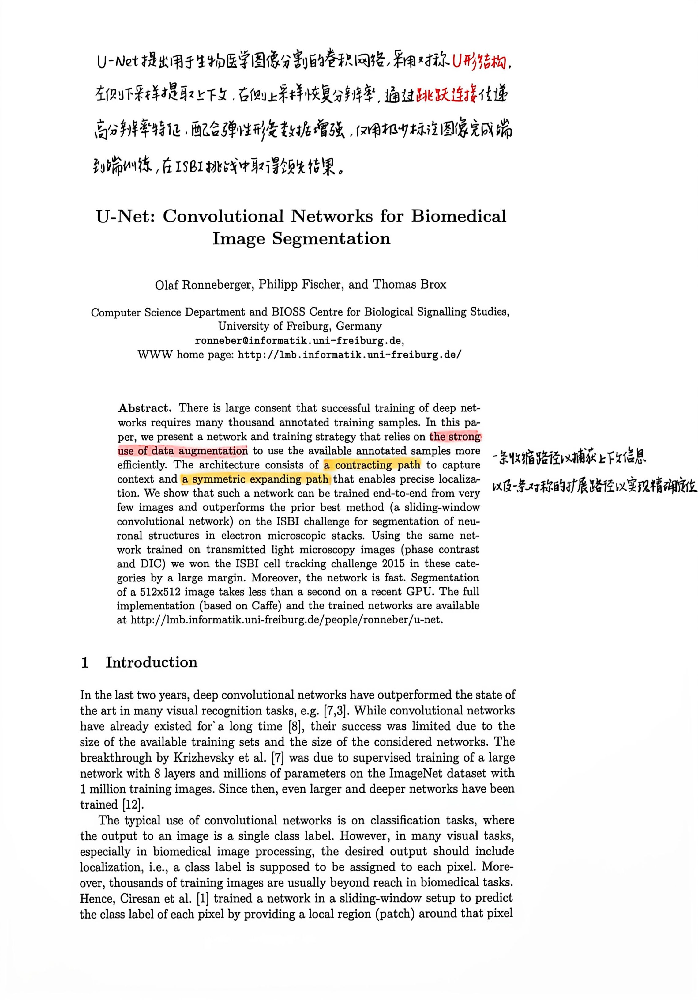
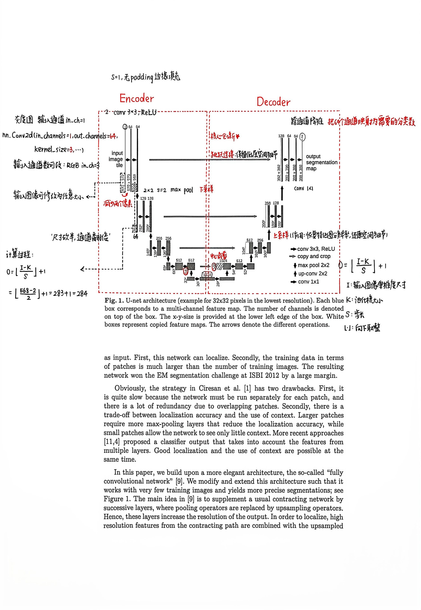
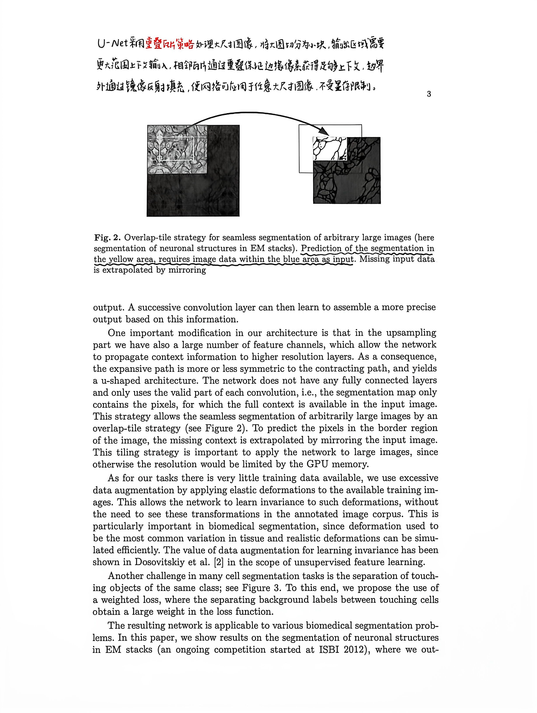
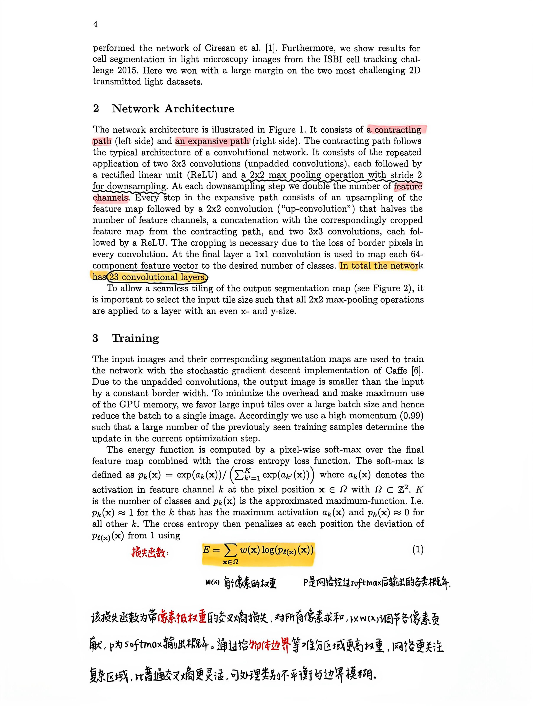
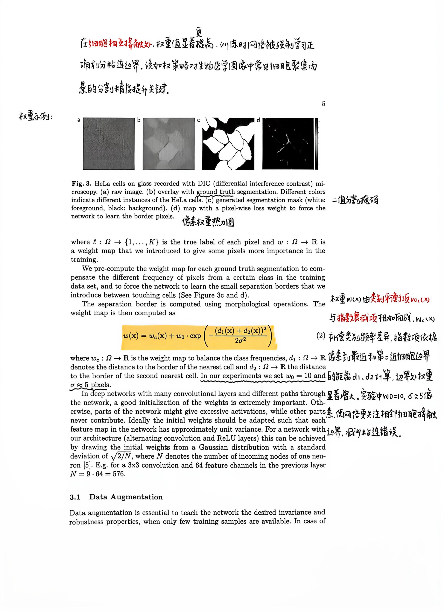
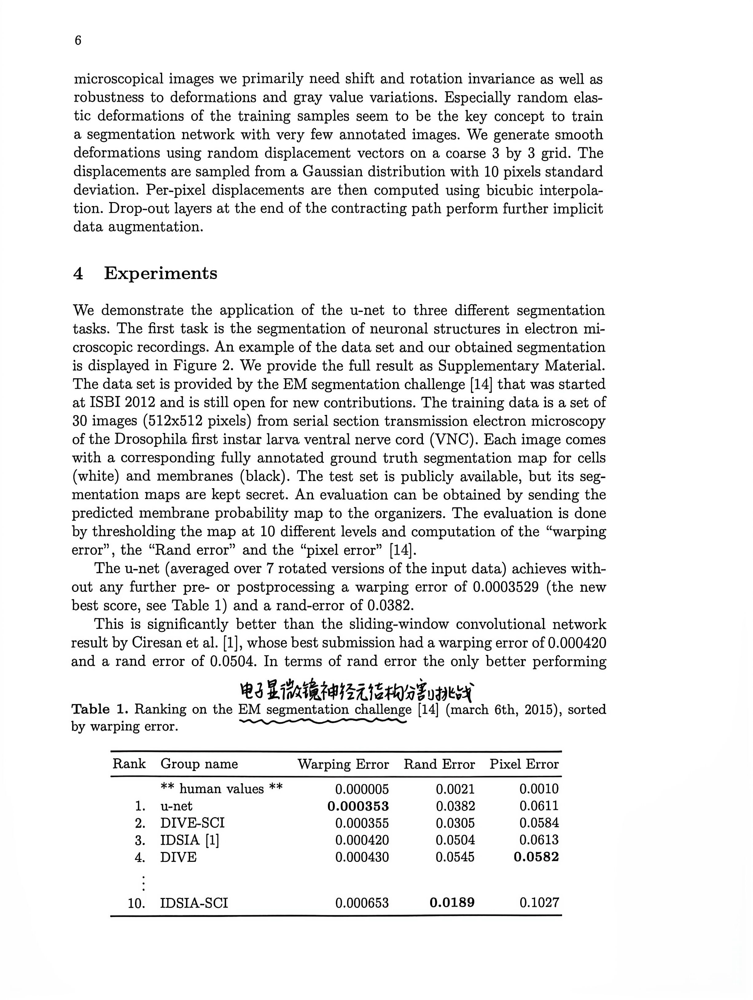
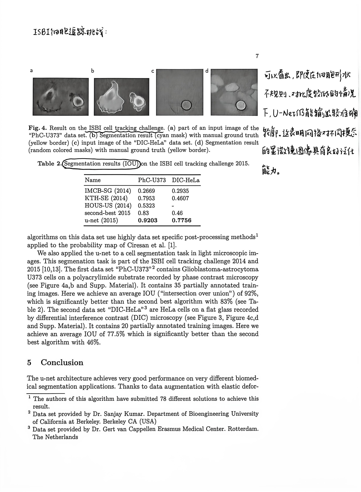
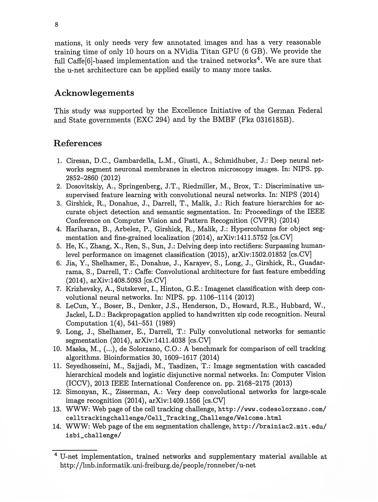

## 2015年《U-Net: Convolutional Networks for Biomedical Image Segmentation》

·做了什么：提出U-Net，用端到端卷积网络对生物医学显微图像进行像素级分割，并在少量标注样本下取得良好效果。

·输入与输出：输入为显微图像（训练时配有对应的像素级标注）；输出为每个像素的类别概率或分割标签图。原论文网络采用无填充卷积，因此输出区域比输入图像小。

·创新点：采用对称的收缩路径与扩张路径，并通过跳跃连接融合浅层定位信息和深层语义信息；同时以弹性形变增强应对小样本，并加权强调相邻细胞间的分隔边界。

·损失函数：像素级softmax加权交叉熵。权重图用于平衡类别频次，并提高细胞间狭窄分隔区域对训练的影响；按常见最小化写法即加权负对数似然。

·意义价值：它证明了结合多尺度特征融合与针对性数据增强，分割模型可以在标注数据有限的生物医学任务中实现准确、实用的像素级分割。

------------------------------------------------问答------------------------------------------------

问：第一个卷积层用 64 个卷积核对一张灰度图做卷积，输出通道为 64 我理解，但第二个卷积层也是 64 个卷积核为什么输出通道还是 64 而不是 64*64 呢？

答：64是论文设定

输出通道数 = 这一层卷积核的数量

现在一个卷积核不再只看 1 张灰度图了。

一个卷积核，同时和全部 64 张输入特征图分别卷积，然后把 64 张的结果相加融合，最后只产出 1 张输出特征图！

问：那这个通道数就是提取的特征对吧，那可以设置的无限大吗

答：不是通道越多，效果就越好。

经典 U-Net：64 → 128 → 256 → 512 → 1024

常见上限：512 / 1024，少数任务用到 2048，再往上很少见。

问：为什么下采样，通道数会翻倍？

答：下采样本身不会自动让通道翻倍！下采样（MaxPool）只压缩空间；通道翻倍，是紧跟在池化之后那一组卷积，人为设置的超参设计。

1. MaxPool（下采样）：只把 H、W 除以 2，**通道数完全不变**

例：shape [B,64,256,256] → pool 之后 → [B,64,128,128]，C 还是 64

紧接着的 Double Conv：我们手动设置 out_channels=128，通道才变成两倍

问：64 → 128 → 256 → 512 → 1024这就是所说的浅层特征到深层特征吗  还是1-64-64也是？

答：64 → 128 → 256 → 512 → 1024 这一串，就是从浅层特征逐步走向深层（高层）特征；

而 1→64→64 只是【第一层块内部】，属于最开头的浅层部分，不是深浅变化这条递进链。

## 图片

|  |  |  |  |
| --- | --- | --- | --- |
|  |  |  |  |
