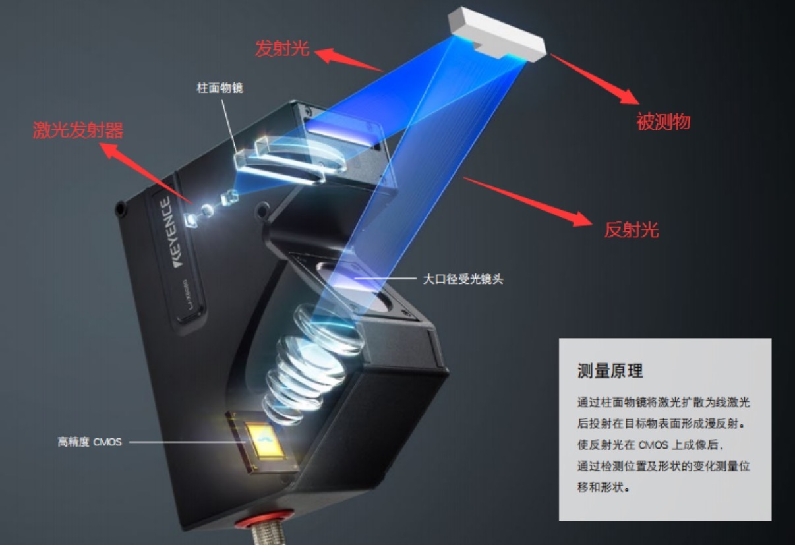
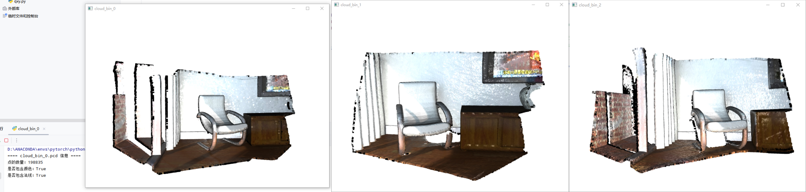
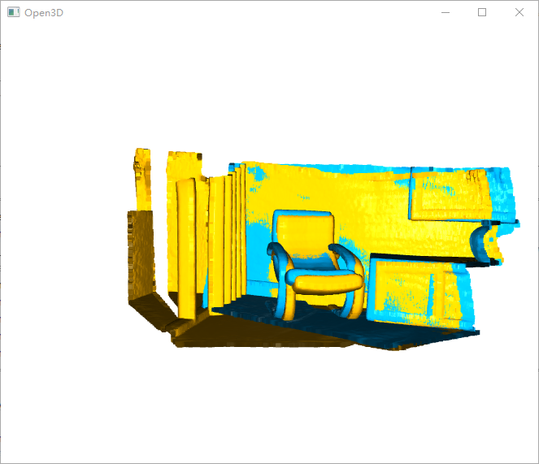
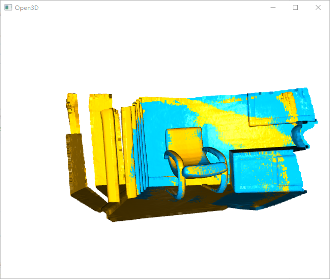
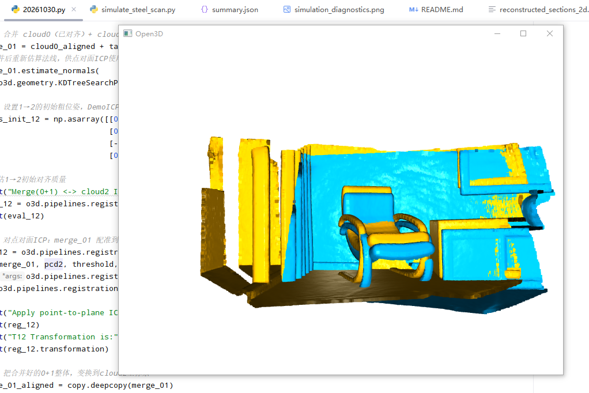
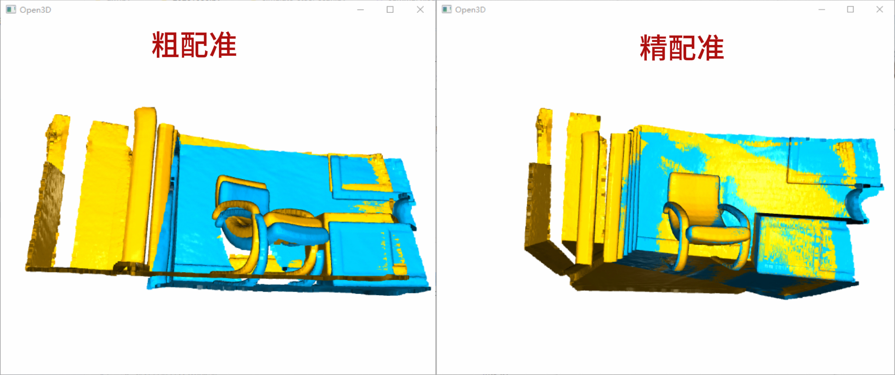
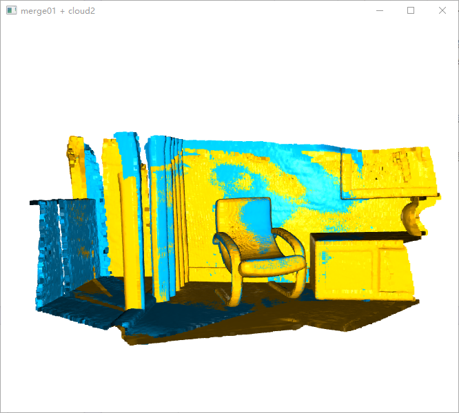
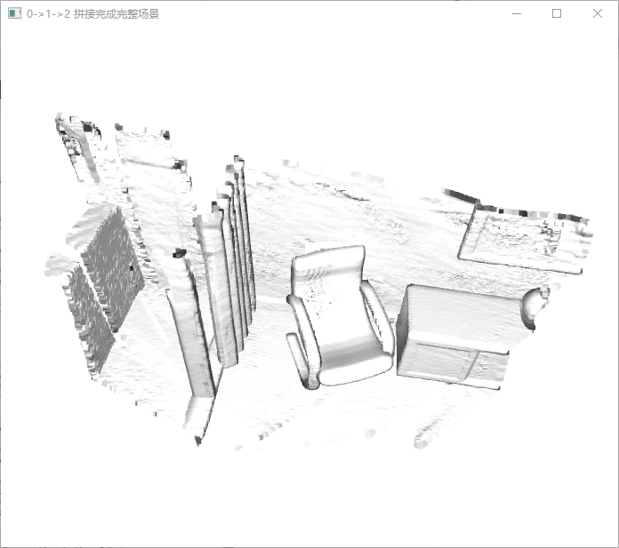
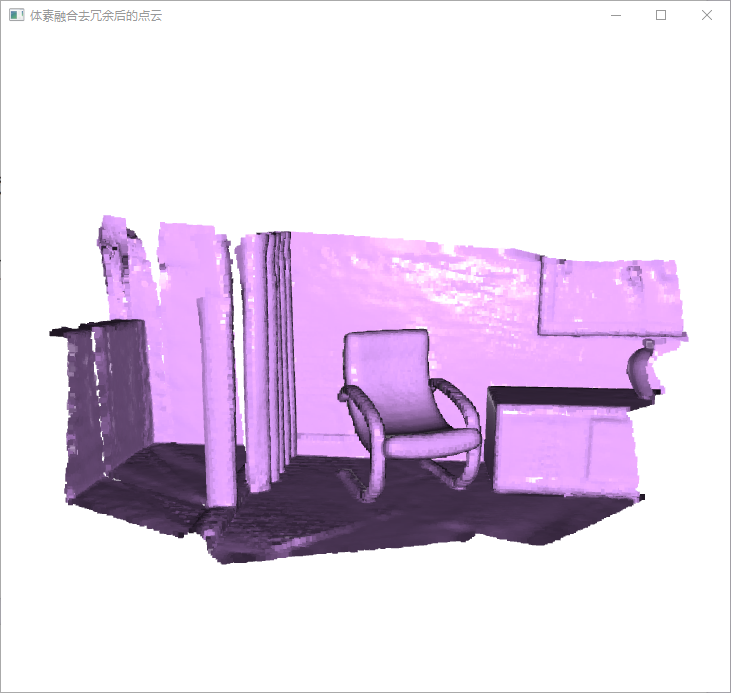
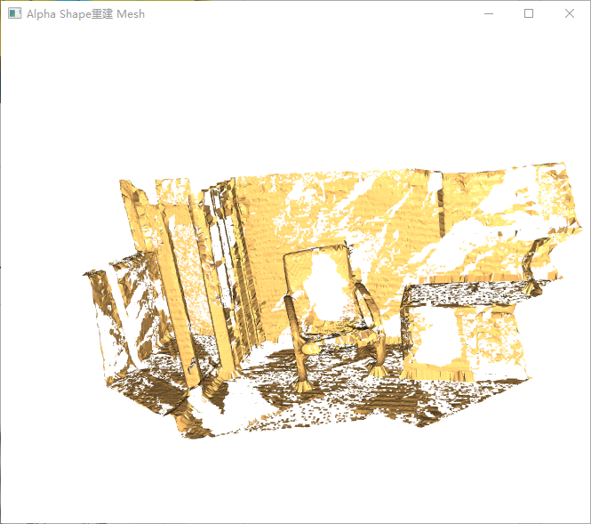

## 激光轮廓仪

**工作原理：激光三角测量。** 这是工业在线检测中最常用的原理。激光器发射一束激光（通常为红色或蓝色）照射到被测物体表面，反射光通过接收镜头成像在 CMOS 或 CCD 传感器上。当物体表面高度发生变化时，反射光斑在传感器上的位置也会发生相应移动。通过三角几何关系，系统可以计算出物体表面各点的高度信息，从而形成轮廓曲线。蓝色激光因波长较短，聚光密度更高，能有效减少杂散光干扰，提高测量精度。

## 从单条 XZ 轮廓获取面信息

单台线激光轮廓仪每次输出一条 X-Z 截面轮廓。钢材沿 Y 方向运动时，采用编码器位移触发采集；上位机同步编码器位置，为每帧轮廓赋予 Y 坐标，并将 X-Z 点转换为 X-Y-Z 点，连续堆叠形成钢材可见表面的三维点云。

## 点云配准与三维重构

点云配准（Point Cloud Registration）就是把不同视角或不同时间采集到的点云对齐到同一坐标系里，让它们在空间上重合，从而实现建图、三维重建、定位、检测变化等。实际流程往往采用“粗到细”的两阶段策略：首先进行预处理（去噪、体素下采样、法向量估计、地面或动态点剔除等）以提升匹配稳定性与效率；随后开展粗配准以获得可靠初值，常见做法包括基于关键点与局部描述子的特征匹配（如 FPFH、SHOT 等），并结合 RANSAC、4PCS 等全局一致性检验来抑制外点、解决较大初始位姿误差；在此基础上进行精配准以进一步细化位姿，典型方法是 ICP 系列（点到点、点到面、广义 ICP 等）或概率/网格化方法（如 NDT）。这些方法通过迭代建立对应关系并最小化距离或残差来优化，但往往对初始值敏感、可能陷入局部最优，因此工程上常引入鲁棒损失函数（Huber、Cauchy）、截断/修剪策略（Trimmed ICP）、外点剔除与多分辨率（金字塔）优化以增强收敛与抗噪能力。点云配准广泛用于 LiDAR/视觉 SLAM、三维重建、工业检测与变化检测等任务，其效果通常以旋转/平移误差、RMSE、内点率、收敛速度，以及在低重叠、遮挡、对称结构与动态场景下的鲁棒性来评估。

## 粗配准、精配准、点云融合与三维重构

示例采用 Open3D 官方内置的 ICP 配准教学数据集类，包含三帧室内点云碎片：`cloud_bin_0.pcd`、`cloud_bin_1.pcd`、`cloud_bin_2.pcd`。

### 粗配准

粗配准为 ICP 精配准提供一个粗略的旋转平移初始位姿。它通过全局搜索得到变换，目的是将两片点云大致对齐，使 ICP 能够在正确的收敛域内迭代，避免收敛到错误的局部最优解。

**① FPFH + RANSAC**

**② FGR**

**③ 人工给定初始变换**，用于方便观察。

**表 1：三种配准方式结果对比**

| 配准方式 | fitness | inlier_rmse | 评价 |
| --- | ---: | ---: | --- |
| 人工固定初值 | 0.1747（低） | 0.01177（小） | 整体对齐差，仅少量点碰巧对上；只适合 Demo 测试，工程不能用 |
| FPFH + RANSAC | 0.6723（高） | 0.03312（偏大） | 找到了正确全局位置，但姿态偏差偏大 |
| FGR | 0.6689（高） | 0.02298（中等偏大） | 和 RANSAC 重叠占比接近，对齐精度更好，是三者里最优的粗配准初值 |

`fitness` 表示有效匹配点的比例，可理解为两片点云的有效重叠程度，越大越好。`inlier_rmse` 表示有效匹配点之间的均方根距离，单位与点云一致，越小越好。

### 精配准：ICP

精配准使用 point-to-point ICP 和 point-to-plane ICP。

- point-to-point ICP：`fitness=6.212085e-01`，`inlier_rmse=6.567257e-03`
- point-to-plane ICP：`fitness=6.210677e-01`，`inlier_rmse=6.564741e-03`

### 将 0+1 点云变换到 cloud 2 坐标系

图中黄色为 0+1，青色为 2。

### 简单拼接

坐标对齐后直接叠加。

### 点云融合

点云融合（体素融合、去冗余）用于消除重叠区域的重复采样点，并均衡点密度。

### 三维模型重构

